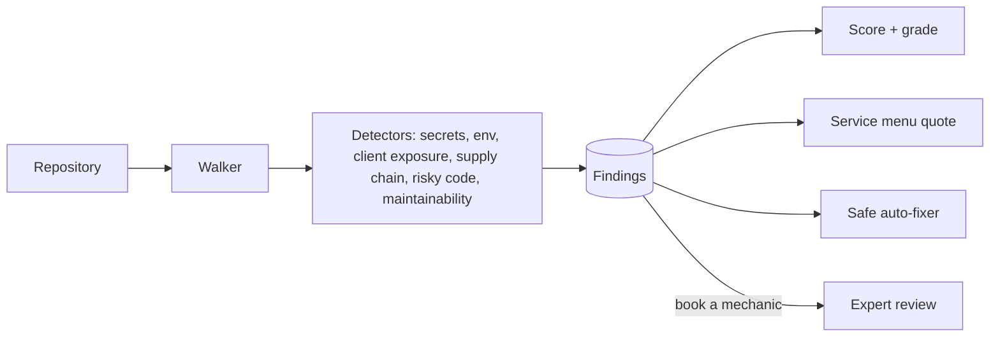

# Architecture — vibe-lube

## 1. Scope
Fast inspection and safe tune-ups for AI-built ("vibe-coded") apps.
**MVP:** repository walker (skips vendored and build directories) with detectors for secrets, env
hygiene, client-side secret exposure, supply chain, risky code and maintainability. Severity-weighted
health score and grade, a service menu quote, and safe auto-fixes only (`.gitignore` env entries,
names-only `.env.example`).
**Product:** GitHub App on every PR, runtime checks against the deployed URL, agent-generated fix PRs with human review.

## 2. System context

## 3. Detector design
Each detector is a pure function over a file's lines (plus repo-level checks), emitting
`Finding{rule, severity, file, line, detail, fix}`. Secrets are **masked in findings**
(`first6...last2`) so reports are safe to share. Severity points are critical 25, high 12,
medium 5, low 1.

## 4. Design decisions
- **Safe fixes only, automatically.** Anything that could break the app (rotating keys,
  refactoring SQL) is a menu item for a human. Generated `.env.example` contains **names only, never values**.
- **Client-side heuristics** (`src/`, `app/`, `pages/`, `components/` minus `/api/`) to flag
  `service_role` and public-prefixed secrets. These are the most common catastrophic leaks in
  Supabase and Next.js vibe apps.
- **Placeholder suppression** (`example`, `xxxx`) cuts false positives in docs and tests.
- **Exit code reflects grade** (A–C → 0, D–F → 1) so it can gate CI.

## 5. Production architecture
A GitHub App (webhooks → job queue → sandboxed scanner container → check-run annotations).
Runtime probes (`/.env`, `/.git/config`, open Supabase tables via the anon key, missing RLS).
A fix-PR generator (agent) behind mandatory human approval.

## 6. Risks
Regex secret detection has false positives and negatives, so entropy checks and provider-specific
validators come next. Never transmit discovered secrets: masking happens at detection time.
